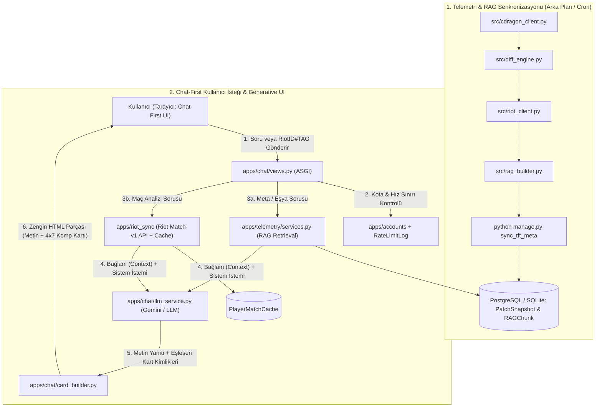

# TFT Set 18 AI Coach & Meta Platform — Sistem Mimarisi (ARCHITECTURE.md)

Bu belge, **`v2-chat-platform`** dalında geliştirilen **Django Tabanlı Chat-First (Sohbet Odaklı) TFT Yapay Zekâ Koçluk Platformu** ile mevcut [`src/`](file:///C:/Users/besir_secilmis/.gemini/antigravity/scratch/tft-meta-analyzer/src) veri/telemetri motorunun uçtan uca sistem mimarisini tanımlar.

---

## 1. Mimari Vizyon: "Chat-First + Generative UI"

Platformun **ana sayfası (`/`)** klasik bir veri tablosu değil, **ChatGPT / Perplexity tarzı tam ekran bir TFT Yapay Zekâ Koçluk Arayüzüdür**.
Ancak bu arayüz yalnızca düz metin (text) döndürmez; kullanıcının sorusuna göre sohbet balonunun içinde **zengin görsel bileşenler (Generative UI Cards)** üretir:
* **Görsel Kompozisyon Kartları:** Şampiyon ikonları, yıldız seviyeleri, BiS (En İyi) eşya dizilimleri, açılır 4x7 altıgen (hex) tahta dizilimi ve **Tek Tıkla Oyun İçi Team Planner Kodu Kopyalama** butonu.
* **Eşyadan Komp Bulucu ("Elimdekilerle Ne Oynarım?") Çubuğu:** Sohbet kutusunun üstünde hızlı eşya bileşeni seçici (ör. `B.F. Kılıcı` + `Gözyaşı`).
* **Riot ID ile Maç Sonu Koçluk (`Post-Game AI Review`):** Oyuncunun `RiotID#TAG` bilgisini girerek son maçlarındaki tahta, ekonomi, eklenti ve lobideki diğer 7 oyuncuya göre yaptığı hataları analiz ettirmesi.
* **Yan Çekmeceler (Slide-Over Drawers):** Sohbetten ayrılmadan tek tıkla yan panelde açılan **Canlı Meta Tier Listesi**, **CDragon Yama Farkları (Buff/Nerf)**, **Eklenti Rehberi** ve **Set 18 Karşılaşma/Tılsım Telemetrisi**.

---

## 2. Hedef Klasör ve Modül Düzeni (`v2-chat-platform`)

Mevcut [`src/`](file:///C:/Users/besir_secilmis/.gemini/antigravity/scratch/tft-meta-analyzer/src) veri motoru **hiç bozulmadan** korunur ve Django uygulamaları tarafından doğrudan bir Python paketi olarak çağrılır:

```text
tft-meta-analyzer/
├── config/                         # Django 5.x Ana Proje Yapılandırması
│   ├── __init__.py
│   ├── asgi.py                     # ASGI giriş noktası (SSE / Streaming yanıtlar için)
│   ├── settings.py                 # Ortam tabanlı (Dev: SQLite / Prod: PostgreSQL) ayarlar
│   ├── urls.py                     # Kök URL yönlendiricisi
│   └── wsgi.py                     # WSGI giriş noktası
├── apps/                           # Modüler Django Uygulamaları
│   ├── core/                       # Ana sayfa, yan çekmeceler (Drawers), dil (TR/EN) ve sağlık kontrolü
│   │   ├── models.py
│   │   ├── views.py                # Chat-First ana ekran + HTMX çekmece uç noktaları
│   │   └── urls.py
│   ├── accounts/                   # Kullanıcı üyeliği, Riot ID bağlama ve mesaj kotası yönetimi
│   │   ├── models.py               # UserProfile, Quota / Plan yönetimi
│   │   ├── services.py             # Kota kontrolü ve Riot PUUID doğrulama servisi
│   │   ├── views.py
│   │   └── urls.py
│   ├── telemetry/                  # src/ veri motorunu veritabanı ile senkronize eden katman
│   │   ├── models.py               # PatchSnapshot, RAGChunk
│   │   ├── services.py             # RAG arama (Retrieval) ve görsel kart (UI Card) eşleştirici
│   │   └── management/
│   │       └── commands/
│   │           └── sync_tft_meta.py # python manage.py sync_tft_meta (src/ hattını çalıştırıp DB'ye yazar)
│   ├── riot_sync/                  # Resmi Riot API (Account-v1, TFT-Match-v1, TFT-League-v1) entegrasyonu
│   │   ├── models.py               # PlayerMatchCache
│   │   ├── client.py               # Hız sınırlamalı (Rate-Limited) resmi Riot API istemcisi
│   │   ├── analyzer.py             # Maç sonu (Post-Game) hata ve lobi rekabet (contested) analizörü
│   │   └── views.py
│   └── chat/                       # Yapay Zekâ Koçluk Sohbet Motoru
│       ├── models.py               # ChatSession, ChatMessage, RateLimitLog
│       ├── llm_service.py          # Gemini 2.5/3.5 Flash & GitHub Models akışlı (Streaming) istemcisi
│       ├── card_builder.py         # AI yanıtına eklenecek interaktif Kompozisyon/Eklenti/Maç kartı üreticisi
│       ├── views.py                # SSE (Server-Sent Events) / HTMX sohbet uç noktaları
│       └── urls.py
├── src/                            # MEVCUT ÇEKİRDEK VERİ MOTORU (Korunur & Doğrudan İmport Edilir)
│   ├── cdragon_client.py           # CommunityDragon & DataDragon veri çekici
│   ├── diff_engine.py              # Matematiksel şampiyon ve özellik yama farkı motoru
│   ├── riot_client.py              # MetaTFT Master+ kümeleme, BiS eşya, Eklenti ve Mekanik istemcisi
│   ├── meta_synthesizer.py         # Çift dilli yönetici özeti üretici
│   ├── dashboard_builder.py        # Statik docs/ derleyici (main dalı uyumluluğu için korunur)
│   ├── rag_builder.py              # RAG bilgi parçacığı (chunk) üretici
│   └── main.py                     # CLI orkestratörü
├── templates/
│   ├── index.html.j2               # Statik yedek şablon (korunur)
│   └── django/                     # Django + HTMX + Tailwind CSS Şablonları
│       ├── base.html               # Hextech koyu tema ana iskeleti
│       ├── chat_home.html          # Tam ekran Chat-First ana sayfa
│       ├── partials/               # HTMX parçalı şablonları
│       │   ├── message_bubble.html # Sohbet balonu + Generative UI kartları
│       │   ├── comp_card.html      # Sohbet içi interaktif Kompozisyon + 4x7 Tahta kartı
│       │   ├── match_card.html     # Riot ID Maç Sonu Koçluk analiz kartı
│       │   ├── drawer_meta.html    # Yandan açılır Meta & Yama çekmecesi
│       │   └── opener_bar.html     # "Elimdeki Eşyalarla Ne Oynarım?" seçim çubuğu
├── manage.py                       # Django yönetim betiği
├── ARCHITECTURE.md                 # Sistem mimarisi (bu belge)
├── DATABASE.md                     # Veritabanı şeması ve ORM tasarımı
├── RULES.md                        # Kodlama ve Riot API uyumluluk kuralları
└── PLAN.md                         # Görev bazlı (Task-by-Task) uygulama yol haritası
```

---

## 3. Uçtan Uca Veri ve Sohbet Akışı



---

## 4. Teknoloji Seçimleri ve Gerekçeleri

1. **Django 5.x (ASGI Modu):**
   * **Neden:** Mevcut [`src/`](file:///C:/Users/besir_secilmis/.gemini/antigravity/scratch/tft-meta-analyzer/src) veri motorumuz %100 Python olduğu için hiçbir dili yeniden yazmadan doğrudan `from src.rag_builder import RAGBuilder` şeklinde kullanılır. Ayrıca Django'nun hazır Admin paneli (`/admin`), ORM'i, oturum (session) yönetimi ve güvenlik katmanları (CSRF, XSS, Rate Limiting) kutudan hazır çıkar.
2. **HTMX + Server-Sent Events (SSE) + Tailwind CSS:**
   * **Neden:** React/Next.js gibi ayrı bir Node.js projesi ve karmaşık state yönetimi kurmak yerine, Django şablonlarından doğrudan parçalı HTML (`partials/message_bubble.html`, `partials/comp_card.html`) döndürerek hem çok hızlı geliştirme yapılır hem de sohbet içinde 4x7 tahta dizilimi ve Team Planner kopyalama kartları sıfır gecikmeyle render edilir.
3. **Veritabanı Stratejisi (Geliştirme: SQLite -> Canlı: PostgreSQL):**
   * Yerel geliştirmede kurulum gerektirmeyen **SQLite (JSON1 destekli)** kullanılır.
   * Canlı sunucuda (Production) `DATABASE_URL` ortam değişkeniyle tek satır kod değiştirmeden **PostgreSQL**'e geçilir.
4. **Riot Games Politikalarına %100 Uyum:**
   * Eklentiler (Augments) için sayısal kazanma oranı (`win_rate`) ve ortalama bitiriş sırası (`avg_place`) **kesinlikle gösterilmez**; yalnızca küratörlü harf kademeleri (`S / A / B / C Tier`), aşama (`2-1`, `3-2`, `4-2`), taktiksel etiketler ve uyumlu kompozisyonlar sunulur.
   * Canlı oyun içi otomatik karar verici (in-game overlay autopilot) **yoktur**; platform tamamen oyun dışı strateji ve **maç sonu (post-game) analiz** koçudur.

---

## 5. Domain ve Canlıya Geçiş (Production Deployment) Mimarisi

Domain alındığında uygulanacak canlı ortam topolojisi:

1. **DNS & Güvenlik Katmanı:** Domain **Cloudflare DNS**'e bağlanır (Ücretsiz SSL/TLS, DDoS koruması, statik görsel önbellekleme).
2. **Uygulama Sunucusu:** `Uvicorn` / `Gunicorn` ASGI sunucusu (Railway, Render, Fly.io veya Hetzner/DigitalOcean VPS üzerinde Docker/Systemd ile).
3. **Statik Dosyalar:** `WhiteNoise` ara katmanı ile CSS/JS dosyaları doğrudan Django üzerinden sıkıştırılmış (Brotli/Gzip) olarak sunulur.
4. **Periyodik Veri Güncelleme:** Her 6 saatte bir `python manage.py sync_tft_meta` komutu çalışarak CDragon/MetaTFT verilerini çeker ve aktif `PatchSnapshot` ile `RAGChunk` kayıtlarını kesintisiz günceller.
