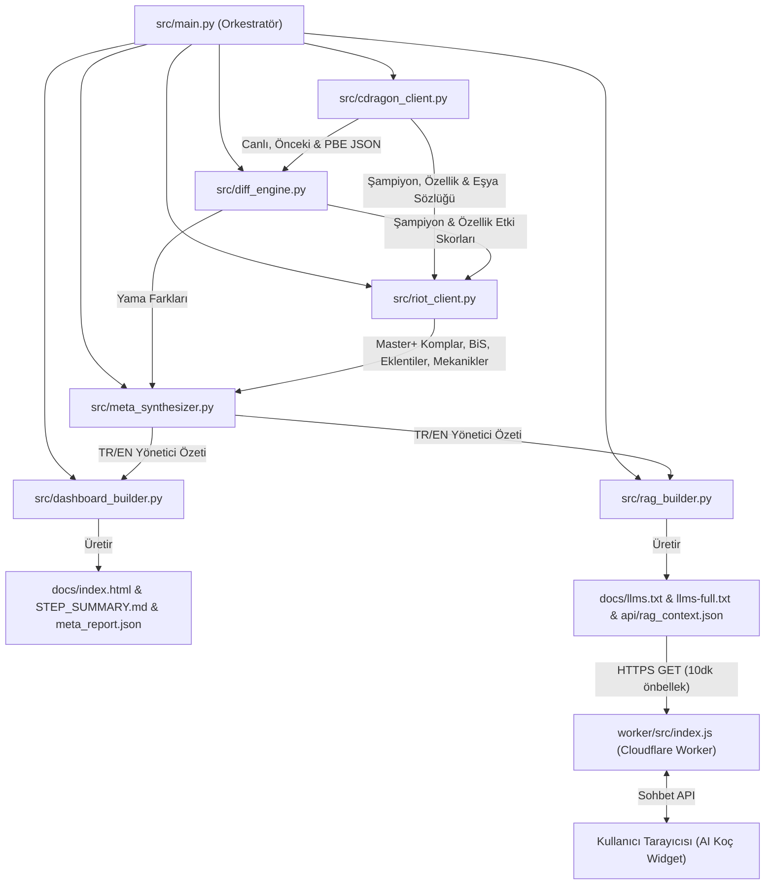

# TFT Set 18 Meta & Patch Telemetry — Sistem Mimarisi (ARCHITECTURE.md)

Bu belge, **TFT Set 18 (`TFTSet18`) Meta & Patch Intelligence Pipeline** projesinin mevcut kod tabanını, dizin yapısını, teknoloji yığınını, veri akışını ve dış servis entegrasyonlarını doğrudan kaynak kodlara dayanarak tanımlar.

---

## 1. Klasör ve Dosya Düzeni

```text
tft-meta-analyzer/
├── .github/
│   └── workflows/
│       └── tft-meta-pipeline.yml   # 4 aşamalı (DAG) GitHub Actions CI/CD iş akışı
├── .cache/                         # CDragon gzip JSON önbelleği (git tarafından yoksayılır)
├── data/
│   └── state.json                  # Son çalışan yama sürümleri ve SHA-256 veri parmak izleri
├── docs/                           # GitHub Pages tarafından sunulan statik çıktılar
│   ├── api/
│   │   └── rag_context.json        # AI Koç ve dış RAG sistemleri için anahtar kelimeli bilgi parçacıkları
│   ├── .nojekyll                   # GitHub Pages Jekyll işlemesini devre dışı bırakan işaret dosyası
│   ├── index.html                  # Jinja2 ile üretilen tek sayfalık (SPA benzeri) çift dilli paneller
│   ├── llms.txt                    # llmstxt.org standardında özet AI bilgi indeksi
│   ├── llms-full.txt               # Tüm yama, komp, eklenti ve mekanikleri içeren tam Markdown bilgi bankası
│   ├── meta_report.json            # Tüm pipeline çıktısını barındıran ham yapılandırılmış JSON
│   └── STEP_SUMMARY.md             # GitHub Actions $GITHUB_STEP_SUMMARY için üretilen Markdown özet tablo
├── src/
│   ├── __init__.py                 # Sabitler: TARGET_MUTATOR = "TFTSet18", TARGET_SET_NUMBER = 18
│   ├── cdragon_client.py           # CommunityDragon & DataDragon sürüm çözücü ve veri çekici
│   ├── diff_engine.py              # Matematiksel şampiyon (1/2/3 yıldız) ve özellik (trait) yama farkı motoru
│   ├── riot_client.py              # MetaTFT Master+ kümeleme, BiS eşya, Eklenti, Set 18 mekanik ve Riot API istemcisi
│   ├── meta_synthesizer.py         # GitHub Models (gpt-4o-mini) + kural tabanlı yedekli yönetici özeti üretici
│   ├── dashboard_builder.py        # Jinja2 tabanlı HTML ve STEP_SUMMARY.md derleyici
│   ├── rag_builder.py              # llms.txt, llms-full.txt ve rag_context.json üretici
│   └── main.py                     # CLI orkestratörü (--check-only ve --force modları)
├── templates/
│   └── index.html.j2               # Tailwind CSS + Vanilla JS tabanlı çift dilli (TR/EN) ana şablon
├── tests/
│   ├── test_diff_engine.py         # Şampiyon/özellik buff-nerf ve etki skoru birim testleri
│   ├── test_rag_builder.py         # Türkçe karakter normalizasyonu ve RAG chunk birim testleri
│   └── test_mechanics.py           # Eklenti tier listesi, karşılaşmalar, tılsımlar ve şablon render testleri
├── worker/                         # Cloudflare Worker tabanlı sunucusuz (serverless) AI Koç RAG vekili
│   ├── src/
│   │   └── index.js                # RAG chunk eşleştirme, hız sınırlama (rate-limit), CORS ve Gemini API vekili
│   ├── wrangler.toml               # Cloudflare Worker yapılandırması (gemini-3.5-flash)
│   └── README.md                   # Worker kurulum ve dağıtım kılavuzu
├── .env.example                    # Ortam değişkenleri şablonu (RIOT_API_KEY, DISCORD_WEBHOOK_URL vb.)
├── .gitignore                      # Git tarafından takip edilmeyen önbellek ve gizli dosyalar
├── pytest.ini                      # Pytest yapılandırması (pythonpath = ., testpaths = tests)
├── requirements.txt                # Python bağımlılıkları
└── README.md                       # Proje genel tanıtım ve kullanım kılavuzu
```

---

## 2. Teknoloji Yığını ve Bağımlılıklar

### 2.1. Python Veri Hattı (Backend / Veri Mühendisliği)
* **Çalışma Zamanı:** Python 3.12+ (yerel ortamda Python 3.14 ile de tam uyumlu).
* **Paket Bağımlılıkları ([`requirements.txt`](file:///C:/Users/besir_secilmis/.gemini/antigravity/scratch/tft-meta-analyzer/requirements.txt)):**
  * `requests>=2.31.0`
  * `Jinja2>=3.1.3` (Statik HTML ve Markdown şablonlama)
  * `pytest>=8.0.0` (Birim ve entegrasyon test çatısı)
* **Standart Kütüphane Kullanımı:** Ağ istekleri, sıkıştırma ve paralellik için harici ağır kütüphaneler yerine Python standart modülleri (`urllib.request`, `gzip`, `hashlib`, `json`, `re`, `unicodedata`, `concurrent.futures.ThreadPoolExecutor`) doğrudan kullanılır.

### 2.2. Ön Yüz (Frontend / Statik Dashboard)
* **Şablon Motoru:** Jinja2 ([`templates/index.html.j2`](file:///C:/Users/besir_secilmis/.gemini/antigravity/scratch/tft-meta-analyzer/templates/index.html.j2)) ile derleme zamanında (build-time) tek bir [`docs/index.html`](file:///C:/Users/besir_secilmis/.gemini/antigravity/scratch/tft-meta-analyzer/docs/index.html) üretilir.
* **Stil & Tasarım:** Tailwind CSS CDN + özel yüksek kontrastlı koyu tema değişkenleri (`#0a0e17` zemin, `#121722` kart yüzeyi, `#222d42` kenarlıklar, `#f0c374` Hextech altını).
* **Fontlar:** `Inter` (arayüz) ve `JetBrains Mono` (sayısal telemetri ve kodlar).
* **İstemci Tarafı Mantığı:** Sıfır çerçeve (Vanilla ES6+ JavaScript). Sayfa yenilemeden çalışan `TR / EN` dil değiştirici (`data-lang` özniteliği), sekme yönetimi, eşyadan kompozisyon bulucu, arama/filtreleme ve AI Koç sohbet penceresi.

### 2.3. Sunucusuz AI Koç (Edge / Cloudflare Worker)
* **Çalışma Zamanı:** Cloudflare Workers ([`worker/src/index.js`](file:///C:/Users/besir_secilmis/.gemini/antigravity/scratch/tft-meta-analyzer/worker/src/index.js), [`worker/wrangler.toml`](file:///C:/Users/besir_secilmis/.gemini/antigravity/scratch/tft-meta-analyzer/worker/wrangler.toml)).
* **LLM Entegrasyonu:** Google Gemini REST API (`gemini-3.5-flash`, `thinkingBudget: 0`, `maxOutputTokens: 2048`, `temperature: 0.3`).
* **Bilgi Getirme (Retrieval):** GitHub Pages üzerindeki `docs/api/rag_context.json` dosyasını 10 dakikalık (`RAG_CACHE_SECONDS = 600`) bellek içi önbellekle çeker, Türkçe karakter duyarsız anahtar kelime skorlamasıyla en alakalı 8 parçacığı (`TOP_K_CHUNKS = 8`) seçip sistem istemine (system prompt) gömer.

---

## 3. Modüller ve Sorumlulukları



### 3.1. [`src/cdragon_client.py`](file:///C:/Users/besir_secilmis/.gemini/antigravity/scratch/tft-meta-analyzer/src/cdragon_client.py) — `CDragonClient`
* Riot DataDragon (`versions.json`) ve CommunityDragon (`/json/`) üzerinden canlı (`latest`), bir önceki (`previous`) ve `pbe` yama sürümlerini otomatik tespit eder ve oyun içi Set 18 yama etiketlerine (`18.5`, `18.6`, `18.7 (PBE)`) dönüştürür.
* `raw.communitydragon.org/{version}/cdragon/tft/{lang}.json` adresinden Türkçe (`tr_tr`) ve İngilizce (`en_us`) verileri gzip destekli indirir ve `.cache/` klasöründe önbelleğe alır.
* Yalnızca `mutator == "TFTSet18"` olan veriyi ayıklar; oynanabilir şampiyonları `traits and 1 <= cost <= 6` kuralıyla filtreler.
* `compute_set18_fingerprint()` ile şampiyon ve özelliklerin deterministik SHA-256 özetini (16 karakter) hesaplar.
* `resolve_icon_url()` ile `.tex` / `.dds` uzantılı oyun içi varlık yollarını doğrudan erişilebilir CDragon `.png` URL'lerine çevirir.

### 3.2. [`src/diff_engine.py`](file:///C:/Users/besir_secilmis/.gemini/antigravity/scratch/tft-meta-analyzer/src/diff_engine.py) — `Set18DiffEngine`
* İki yama arasındaki şampiyon temel niteliklerini (`hp`, `damage`, `attackSpeed`, `armor`, `magicResist`, `initialMana`, `mana`, `range`) yön ağırlıklarıyla (`STAT_RULES`) karşılaştırır (ör. maksimum mana düşüşü pozitif buff olarak değerlendirilir).
* Şampiyonların 1, 2 ve 3 yıldız yetenek değişkenlerini (`ability.variables`) karşılaştırır; bekleme süresi/maliyet (`cooldown`, `manalock`, `cost`, `delay`) dışındaki artışları pozitif puanlar.
* Her şampiyona ve özelliğe net bir `impact_score` atar ve değişikliği `BUFF`, `NERF`, `REWORK` veya `NEW` olarak sınıflandırır.

### 3.3. [`src/riot_client.py`](file:///C:/Users/besir_secilmis/.gemini/antigravity/scratch/tft-meta-analyzer/src/riot_client.py) — `RiotTFTAnalyzer`
* **Meta Kompozisyonları (`build_set18_meta_compositions`):** MetaTFT kümeleme API'lerinden (`comps_data`, `comps_stats`) Master+ maç verilerini çeker. Her kompozisyon için gerçek tahta boyutunu (`7`, `8`, `9` birim), seviye temposunu (`Fast 8`, `Fast 9`, `lvl 7` vb.), taşıyıcı BiS eşyalarını ve resmi oyun içi **Team Planner kodunu** (`02` + 10x3 hex slot + `TFTSet18`) üretir. Diff Engine'den gelen `impact_score` değerlerini tahtadaki birimlere uygular (taşıyıcılar `1.5x`, diğer birimler `0.75x` ağırlıklı).
* **Eşya & Şampiyon Tier Listesi (`fetch_item_and_unit_tier_lists`):** `unit_items_processed` uç noktasından en çok oynanan eşyaları, şampiyonları ve "Elimdeki Eşyayla Ne Oynanır?" eşleştiricisi için en popüler 18 birleştirilebilir eşyayı çıkarır.
* **Eklenti Tier Listesi (`fetch_augment_tier_list`):** 261 Set 18 eklentisini (Gümüş, Altın, Prizmatik) çeker, `<TFTCurveTable>` etiketlerini gerçek sayısal değerlerle temizler, CDragon Hexcore PNG ikonlarıyla eşleştirir ve `comp_augment_tiers` üzerinden en uyumlu meta kompozisyonlarla bağlar.
* **Set 18 Özel Mekaniği (`fetch_set18_mechanics_telemetry`):** Set 18'in 20 Karşılaşma (Encounter/Portal) kuralını strateji rehberleriyle ve 23 yüksek etkili Dükkân Tılsımını (Charms) altın maliyetleri ve aşama tavsiyeleriyle derler.
* **Bölgesel Liderlik Tablosu (`fetch_regional_leaderboards`):** `ThreadPoolExecutor(max_workers=7)` ile 7 bölgenin (`TR`, `EUW`, `NA`, `KR`, `EUNE`, `VN`, `BR`) Challenger sıralamasını ve GM/Challenger LP barajlarını paralel çeker.
* **Resmi Riot API Telemetrisi (`fetch_official_riot_api_telemetry`):** `RIOT_API_KEY` tanımlıysa Riot'un resmi sunucu durumu ve Challenger lig uç noktalarını doğrular.

### 3.4. [`src/meta_synthesizer.py`](file:///C:/Users/besir_secilmis/.gemini/antigravity/scratch/tft-meta-analyzer/src/meta_synthesizer.py) — `MetaSynthesizer`
* `GITHUB_TOKEN` mevcut olduğunda GitHub Models API (`https://models.inference.ai.azure.com/chat/completions`, model: `gpt-4o-mini`) üzerinden Türkçe ve İngilizce yönetici özeti üretir.
* Token yoksa veya API çağrısı başarısız olursa `_build_bilingual_rule_based_report()` ile deterministik, kesintisiz bir özet üretir.
* `DISCORD_WEBHOOK_URL` tanımlıysa yama özetini Discord kanalına zengin gömülü mesaj (embed) olarak gönderir.

### 3.5. [`src/dashboard_builder.py`](file:///C:/Users/besir_secilmis/.gemini/antigravity/scratch/tft-meta-analyzer/src/dashboard_builder.py) & [`src/rag_builder.py`](file:///C:/Users/besir_secilmis/.gemini/antigravity/scratch/tft-meta-analyzer/src/rag_builder.py)
* `DashboardBuilder`: `templates/index.html.j2` şablonunu işleyerek `docs/index.html`, `docs/meta_report.json`, `docs/.nojekyll` ve `docs/STEP_SUMMARY.md` dosyalarını diske yazar.
* `RAGBuilder`: Raporu 9 farklı tipte (`overview`, `composition`, `augment`, `encounter`, `charm`, `champion`, `item`, `patch_change`, `leaderboard`, `pbe`) arama parçacığına (chunk) dönüştürerek `docs/api/rag_context.json`, `docs/llms.txt` ve `docs/llms-full.txt` dosyalarını üretir.

---

## 4. CI/CD ve GitOps İş Akışı

[`.github/workflows/tft-meta-pipeline.yml`](file:///C:/Users/besir_secilmis/.gemini/antigravity/scratch/tft-meta-analyzer/.github/workflows/tft-meta-pipeline.yml) dosyası 6 saatte bir (`0 */6 * * *`), `main` dalına kod itildiğinde veya manuel tetiklendiğinde 4 sıralı iş (job) olarak çalışır:

1. **`detect-patch`:** Birim testlerini (`pytest`) koşturur ve `python -m src.main --check-only` ile CDragon/DDragon üzerinde yeni bir yama olup olmadığını veya Master+ telemetrisinin 12 saati (`max_hours=12.0`) geçip geçmediğini kontrol eder.
2. **`analyze-set18-meta`:** Değişiklik varsa `python -m src.main --force` çalıştırır, üretilen `docs/` ve `data/state.json` dosyalarını `[skip ci]` etiketiyle repoya geri commitler ve GitHub Pages ile Release işleri için artifact yükler.
3. **`deploy-pages`:** `docs/` klasörünü OIDC yetkilendirmesiyle GitHub Pages'e dağıtır.
4. **`publish-release`:** Canlı yama değiştiğinde veya manuel istendiğinde `meta_report.json`, `llms.txt`, `llms-full.txt` ve `rag_context.json` dosyalarını içeren etiketli bir GitHub Release yayınlar.
