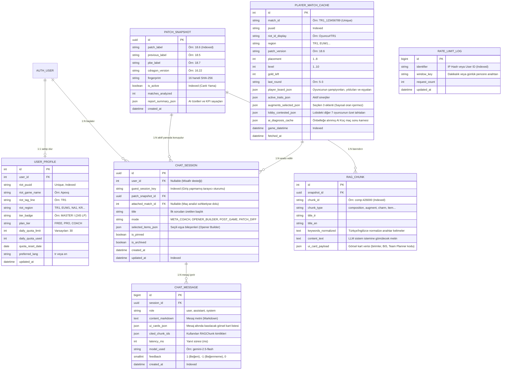

# TFT Set 18 AI Coach Platform — Veritabanı Şeması ve ORM Tasarımı (DATABASE.md)

Bu belge, **`v2-chat-platform`** dalında kurulan Django uygulamasının tüm veritabanı tablolarını, ilişkilerini, indekslerini ve JSON veri yapılarını en ince ayrıntısına kadar tanımlar. Tasarım hem yerel **SQLite** hem de canlı **PostgreSQL** ortamlarıyla %100 uyumludur.

---

## 1. Varlık-İlişki Diyagramı (ER Diagram)



---

## 2. Uygulama Bazlı Tablo ve Model Detayları

### 2.1. `apps.accounts` — Kullanıcı Profili, Riot Bağlantısı ve Kota Yönetimi

#### Model: `UserProfile`
Kullanıcıların Riot hesaplarını (`RiotID#TAG`) profillerine bağlamasını, mevcut liglerini görmesini ve günlük AI mesaj kotalarını yönetir.
* **`user`**: `OneToOneField(settings.AUTH_USER_MODEL, on_delete=models.CASCADE, related_name="profile")`
* **`riot_puuid`**: `CharField(max_length=128, unique=True, null=True, blank=True, db_index=True)` — Riot `account-v1` API'sinden dönen kalıcı oyuncu kimliği.
* **`riot_game_name`** & **`riot_tag_line`**: `CharField(max_length=64)` / `CharField(max_length=16)` — Örn. `Besir` ve `TR1`.
* **`riot_region`**: `CharField(max_length=16, default="TR1")` — `TR1`, `EUW1`, `EUN1`, `NA1`, `KR`, `BR1`, `VN2`.
* **`tier_badge`**: `CharField(max_length=64, blank=True)` — Örn. `"CHALLENGER • 1,120 LP"`.
* **`plan_tier`**: `CharField(max_length=16, choices=[("FREE", "Ücretsiz"), ("PRO", "Pro Koç"), ("ADMIN", "Yönetici")], default="FREE")`
* **`daily_quota_limit`**: `PositiveIntegerField(default=30)` — Ücretsiz kullanıcılar için günlük 30 soru, Pro için 500 soru.
* **`daily_quota_used`**: `PositiveIntegerField(default=0)`
* **`quota_reset_date`**: `DateField(auto_now_add=True)` — Gün değiştiğinde otomatik sıfırlanır.
* **`preferred_lang`**: `CharField(max_length=5, choices=[("tr", "Türkçe"), ("en", "English")], default="tr")`

---

### 2.2. `apps.telemetry` — Yama Sürümleri ve RAG Bilgi Bankası

#### Model: `PatchSnapshot`
[`src/main.py`](file:///C:/Users/besir_secilmis/.gemini/antigravity/scratch/tft-meta-analyzer/src/main.py) tarafından üretilen her yama verisini veritabanında versiyonlu olarak saklar.
* **`id`**: `UUIDField(primary_key=True, default=uuid.uuid4, editable=False)`
* **`patch_label`**: `CharField(max_length=32, db_index=True)` — Örn. `"18.6"`.
* **`previous_label`** & **`pbe_label`**: `CharField(max_length=32)` — Örn. `"18.5"` ve `"18.7"`.
* **`cdragon_version`**: `CharField(max_length=32)` — Örn. `"16.22"`.
* **`fingerprint`**: `CharField(max_length=32, db_index=True)` — CDragon Set 18 SHA-256 parmak izi.
* **`is_active`**: `BooleanField(default=True, db_index=True)` — Şu anda sitede aktif olan canlı yama.
* **`matches_analyzed`**: `PositiveIntegerField(default=0)`
* **`full_report_json`**: `JSONField(default=dict)` — Yan çekmecelerin (Meta Tier List, Yama Diff, Eklentiler, Set 18 Mekanikleri) sıfır hesaplama maliyetiyle anında açılması için tam rapor.

#### Model: `RAGChunk`
Sohbet motorunun milisaniyeler içinde en alakalı TFT bilgisini ve **görsel kart verisini** bulmasını sağlayan indeks tablosu.
* **`snapshot`**: `ForeignKey(PatchSnapshot, on_delete=models.CASCADE, related_name="chunks")`
* **`chunk_id`**: `CharField(max_length=128, db_index=True)` — Örn. `"comp:426000"`, `"augment:TFT18_Augment_..."`, `"charm:TFT18_Charm_..."`.
* **`chunk_type`**: `CharField(max_length=32, db_index=True)` — `overview`, `composition`, `augment`, `encounter`, `charm`, `champion`, `item`, `patch_change`, `leaderboard`, `pbe`.
* **`title_tr`** & **`title_en`**: `CharField(max_length=255)`
* **`keywords_normalized`**: `TextField()` — Türkçe karakter duyarsız arama kelimeleri (`_normalize` çıktısı).
* **`content_text`**: `TextField()` — LLM'e verilecek temiz metin.
* **`ui_card_payload`**: `JSONField(default=dict, blank=True)` — **Kritik Alan!** Eğer bu chunk bir kompozisyon, şampiyon, eklenti veya tılsım ise; sohbet balonunun altında görsel kart çizmek için gereken tüm veriyi barındırır:
  ```json
  {
    "card_type": "composition",
    "comp_name": "4 Meclis LeBlanc",
    "comp_name_en": "4 Coven LeBlanc",
    "tier": "S",
    "levelling": "Fast 8",
    "avg_placement": 4.12,
    "top4_rate": 64.5,
    "win_rate": 18.2,
    "team_planner_code": "02015022031044051062073084000000TFTSet18",
    "units": [
      {"name": "LeBlanc", "cost": 4, "icon": "https://...", "is_carry": true, "bis_items": [...]}
    ],
    "board_grid": [...]
  }
  ```

---

### 2.3. `apps.riot_sync` — Resmi Riot API Maç Önbelleği ve Maç Sonu Analiz

#### Model: `PlayerMatchCache`
Riot Production API Key ile `tft-match-v1` üzerinden çekilen maçları önbelleğe alır. Aynı maç ikinci kez sorulduğunda Riot API kotası harcanmaz, doğrudan veritabanından okunur.
* **`match_id`**: `CharField(max_length=64, unique=True, db_index=True)` — Örn. `"TR1_1592837412"`.
* **`puuid`**: `CharField(max_length=128, db_index=True)`
* **`riot_id_display`**: `CharField(max_length=96, db_index=True)` — Örn. `"Apexq#TR1"`.
* **`region`**: `CharField(max_length=16)`
* **`patch_version`**: `CharField(max_length=32)`
* **`placement`**: `PositiveSmallIntegerField()` — `1` ile `8` arası bitiriş sırası.
* **`level`**: `PositiveSmallIntegerField()` — Oyuncunun ulaştığı son seviye.
* **`gold_left`**: `PositiveSmallIntegerField()` — Elendiğinde veya kazandığında kalan altın.
* **`last_round`**: `CharField(max_length=16)` — Örn. `"4-5"` veya `"6-2"`.
* **`player_board_json`**: `JSONField(default=list)` — Şampiyonlar, yıldız seviyeleri (`tier`), verilen eşyalar ve ikon URL'leri.
* **`active_traits_json`**: `JSONField(default=list)` — Aktif sinerjiler ve seviyeleri.
* **`augments_selected_json`**: `JSONField(default=list)` — Seçilen eklentilerin isim ve ikonları *(Riot kuralları gereği küresel kazanma oranı barındırmaz)*.
* **`lobby_contested_json`**: `JSONField(default=dict)` — Lobideki diğer 7 oyuncunun hangi kompozisyonları ve taşıyıcıları oynadığının özeti (AI Koç'un *"Lobide 3 kişi daha seninle aynı taşıyıcıyı aramış"* diyebilmesi için!).
* **`ai_diagnosis_cache`**: `JSONField(default=dict, blank=True)` — Bu maç için AI Koç'un ürettiği "Güçlü Hamleler", "Kritik Hatalar (Eşya / Ekonomi / Pivot)" ve "Önerilen Alternatif" özeti.
* **`game_datetime`**: `DateTimeField(db_index=True)`

---

### 2.4. `apps.chat` — Sohbet Oturumları, Mesajlar ve Görsel Kartlar

#### Model: `ChatSession`
Sol menüde (Sidebar) listelenen geçmiş sohbet başlıklarını ve sohbetin modunu tutar. Hem üye girişi yapmış kullanıcıları (`user`) hem de üye olmadan siteyi deneyen misafirleri (`guest_session_key`) destekler.
* **`id`**: `UUIDField(primary_key=True, default=uuid.uuid4, editable=False)`
* **`user`**: `ForeignKey(settings.AUTH_USER_MODEL, null=True, blank=True, on_delete=models.CASCADE, related_name="chat_sessions")`
* **`guest_session_key`**: `CharField(max_length=64, db_index=True, blank=True)`
* **`patch_snapshot`**: `ForeignKey(PatchSnapshot, null=True, blank=True, on_delete=models.SET_NULL)`
* **`attached_match`**: `ForeignKey(PlayerMatchCache, null=True, blank=True, on_delete=models.SET_NULL)` — Eğer sohbet bir maç analizi üzerine başlatıldıysa ilgili maça bağlanır.
* **`title`**: `CharField(max_length=160, default="Yeni TFT Koçluk Sohbeti")`
* **`mode`**: `CharField(max_length=24, choices=[("META_COACH", "Genel Meta Koçu"), ("OPENER_BUILDER", "Elimdekilerle Ne Oynarım?"), ("POST_GAME", "Maç Sonu Analizi"), ("PATCH_DIFF", "Yama Analizi")], default="META_COACH")`
* **`selected_items_json`**: `JSONField(default=list, blank=True)` — Kullanıcının sohbet üstü çubuktan seçtiği eşya bileşenleri.
* **`is_pinned`**: `BooleanField(default=False)`
* **`is_archived`**: `BooleanField(default=False)`
* **`created_at`** & **`updated_at`**: `DateTimeField(auto_now_add=True)` / `DateTimeField(auto_now=True, db_index=True)`

#### Model: `ChatMessage`
Bir oturumdaki her bir kullanıcı sorusunu ve AI Koç yanıtını (görsel kartlarıyla birlikte) saklar.
* **`session`**: `ForeignKey(ChatSession, on_delete=models.CASCADE, related_name="messages")`
* **`role`**: `CharField(max_length=16, choices=[("user", "Kullanıcı"), ("assistant", "AI Koç"), ("system", "Sistem")])`
* **`content_markdown`**: `TextField()` — Sohbet metni.
* **`ui_cards_json`**: `JSONField(default=list, blank=True)` — Mesaj balonunun hemen altında render edilecek interaktif görsel kartların (`comp_card`, `augment_card`, `match_review_card`) listesi.
* **`cited_chunk_ids`**: `JSONField(default=list, blank=True)` — Cevap üretilirken kullanılan RAG parçacıklarının kimlikleri.
* **`latency_ms`**: `PositiveIntegerField(default=0)`
* **`model_used`**: `CharField(max_length=64, default="gemini-2.5-flash")`
* **`feedback`**: `SmallIntegerField(default=0)` — `+1` (Faydalı), `-1` (Hatalı), `0` (Oy verilmedi).
* **`created_at`**: `DateTimeField(auto_now_add=True, db_index=True)`

#### Model: `RateLimitLog`
Sunucu maliyeti ve API kotalarını korumak için IP ve kullanıcı bazlı hız sınırlama tablosu.
* **`identifier`**: `CharField(max_length=128, db_index=True)` — SHA-256 IP özeti veya `user:{id}`.
* **`window_key`**: `CharField(max_length=32, db_index=True)` — Örn. `"min:202611111730"` veya `"day:20261111"`.
* **`request_count`**: `PositiveIntegerField(default=1)`
* **`updated_at`**: `DateTimeField(auto_now=True)`
* **`Meta.unique_together`**: `[("identifier", "window_key")]`

---

## 3. İndeksleme ve Performans Kuralları

1. **Sohbet Geçmişi Hızı:** `ChatSession` tablosunda `(user, -updated_at)` ve `(guest_session_key, -updated_at)` bileşik indeksleri (`models.Index`) tanımlanarak sol menüdeki geçmiş sohbetlerin <5ms içinde yüklenmesi sağlanır.
2. **RAG Sorgu Performansı:** Aktif yamaya ait `RAGChunk` kayıtları Django'nun bellek içi önbelleğinde (`LocMemCache` / `RedisCache`, TTL: 10 dakika) tutulur; böylece her sohbet mesajında veritabanına tam tablo taraması yapılmaz.
3. **Riot API Önbellekleme:** `PlayerMatchCache` tablosunda `match_id` tekildir (`unique=True`). Tamamlanmış bir TFT maçının verisi asla değişmeyeceği için, bir kez çekilen maç sonsuza kadar veritabanından okunur ve Riot API hız sınırını (`Rate Limit`) tüketmez.
