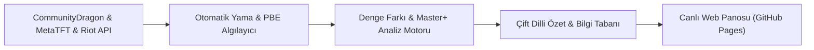

  

  

    
    
    
    
    
  

  

    <strong>Kişisel Teamfight Tactics Canlı Yama Telemetri &amp; Set 19 PBE Erken Bakış Platformu</strong> 
    <em>Otomatik Master+ Meta Analizi &bull; Yama Denge Farkları (Buff/Nerf) &bull; Set 19 PBE Kataloğu &bull; Çift Dil (TR / EN)</em>
  

---

## Proje Hakkında

**TFT Meta & Patch Telemetry**, Teamfight Tactics için geliştirdiğim kişisel ve tamamen otomatik çalışan bir **meta istihbarat ve yama takip platformudur**. Her yeni canlı yama ve PBE güncellemesi otomatik olarak algılanır; şampiyon/özellik denge değişiklikleri, Master+ kompozisyon trendleri ve yeni set önizlemeleri çift dilli (`TR / EN`) canlı web panosunda yayınlanır.

* **Canlı Web Panosu:** [apexq.github.io/TFT-Meta-Patch-Telemetry](https://apexq.github.io/TFT-Meta-Patch-Telemetry/)

---

## Öne Çıkan Özellikler

| Özellik | Açıklama |
| :--- | :--- |
| **Otomatik Yama &amp; Buff/Nerf Motoru** | CommunityDragon verileri üzerinden 1/2/3 yıldızlı yetenek ve temel istatistik farklarını matematiksel etki puanıyla (`impact_score`) hesaplar |
| **Master+ Kompozisyon &amp; BiS Analizi** | Yüksek eloda öne çıkan kompozisyonlar, seviye temposu (`Fast 8`, `Slow Roll`), ana taşıyıcı BiS eşyaları ve tek tık Team Planner kodları |
| **Dinamik Set 19 PBE Erken Bakış** | PBE üzerinde yeni set geçişini otomatik tespit eder; 5G–1G maliyet filtreli şampiyon kataloğu, yeni özellikler ve erken dikey sinerji önizlemeleri sunar |
| **Bölgesel Challenger Sıralaması** | Resmi Riot Games API üzerinden bölgesel Challenger / Grandmaster LP barajları ve üst sıralama takibi |
| **Çift Dil Deneyimi (`TR / EN`)** | Tüm analiz özetleri, şampiyon/özellik isimleri ve arayüz bileşenlerinde anlık Türkçe / İngilizce geçişi |

---

## Sistem Akışı

---

## Erişim, Atıf ve Lisans

Bu repo **canlı web servisini barındırmak, kişisel proje vitrini sunmak ve Riot Games Geliştirici Politikası şeffaflığını sağlamak** amacıyla herkese açık tutulmaktadır.

* **Üçüncü Taraf Kurulum Desteklenmez:** Kişisel bilgisayarlara veya harici sunuculara kurulum/çoğaltma için açık kaynak proje olarak sunulmaz.
* **Lisans &amp; Güvenlik:** Tüm hakları saklıdır ([LICENSE](LICENSE)) &bull; Güvenlik bildirimleri için [SECURITY.md](SECURITY.md).
* **Veri Atıfları:** Master+ kompozisyon kümeleri [MetaTFT.com](https://www.metatft.com), oyun verileri [CommunityDragon](https://communitydragon.org/) &amp; Riot DataDragon, bölgesel sıralamalar [Riot Games Developer API](https://developer.riotgames.com/) kaynaklarından sağlanmaktadır.

---

## Riot Games Yasal Uyarı &amp; Politika Uyumu

**TFT Meta & Patch Telemetry**, Riot Games tarafından desteklenmemektedir ve Riot Games'in veya Riot Games ürünlerinin oluşturulmasında ya da yönetilmesinde resmi olarak yer alan kişilerin görüş ve düşüncelerini yansıtmaz. Riot Games ve Teamfight Tactics, Riot Games, Inc.'nin ticari markaları veya tescilli ticari markalarıdır.

* **Augment Politikası Uyumu:** Riot Games Geliştirici Politikaları gereği eklentilere (Augment) ait sayısal kazanma oranı, ortalama sıralama veya seçilme yüzdeleri rapor ve panolarda yayınlanmaz; eklentiler yalnızca nitel kademe ve aşama rehberliğiyle sunulur.
