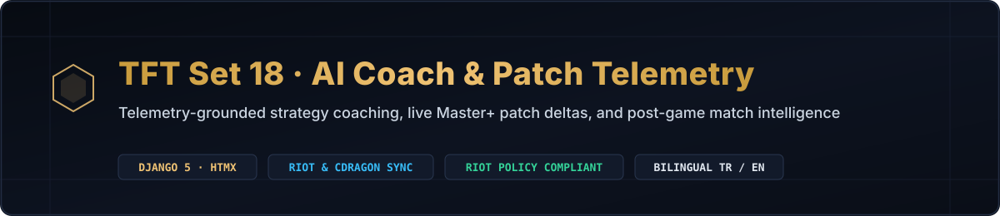
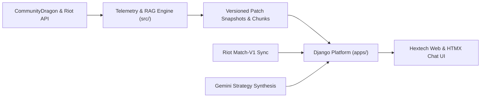

<div align="center">
  

  <p>
    <a href="https://github.com/Apexq/TFT-Meta-Patch-Telemetry/actions/workflows/ci.yml">
      
    </a>
    
    
    
    <a href="LICENSE">
      
    </a>
  </p>

  <p>
    <strong>Telemetry-grounded Teamfight Tactics Set 18 strategy coach, automated patch delta tracker, and post-game match intelligence platform.</strong>
  </p>
</div>

---

## Overview

**TFT Set 18 · AI Coach & Patch Telemetry** combines automated Master+ meta synthesis with a conversational coaching web platform built on Django and HTMX. Every recommendation is anchored directly to verified patch telemetry, curated Set 18 encounters and charms, and in-game Riot ID match history.

### Core Capabilities

| Module | Capability |
| :--- | :--- |
| **Conversational AI Coach** | Multi-turn strategy chat with structured Hextech composition cards, Team Planner (`TFTSet18`) export codes, and adaptive level curves |
| **Automated Patch Telemetry** | Scheduled CommunityDragon & Riot API ingestion computing champion/trait patch deltas, Master+ composition trends, and RAG knowledge chunks |
| **Opener & Item Pivot Guide** | Interactive component-to-board pivot recommendations tailored to early-game items |
| **Post-Game Match Review** | Riot ID (`Match-V1`) match history lookup with board placement diagnostics and itemized carry feedback |
| **Bilingual Experience (`TR / EN`)** | Full Turkish and English localization across coaching prompts, card telemetry, and UI controls |

---

## High-Level Architecture



---

## Repository Structure

```text
.
├── .github/                  # Automated CI, telemetry pipeline, and issue/PR workflows
├── apps/
│   ├── accounts/             # User profiles, daily usage quotas, and guest session transfer
│   ├── chat/                 # Conversational coaching engine, RAG context, and card selection
│   ├── core/                 # Chat-first homepage and meta/augment/mechanics drawers
│   ├── riot_sync/            # Riot ID account linking and post-game match analysis
│   └── telemetry/            # Database-backed patch snapshots and vector-free RAG retrieval
├── config/                   # Django project settings, WSGI/ASGI entrypoints, and URL routing
├── docs/                     # Riot developer domain verification and hosted static outputs
├── src/                      # Core telemetry pipeline, diff engine, and RAG chunk builders
├── templates/                # Hextech dark-theme HTML/HTMX templates and UI partials
└── tests/                    # Automated unit, integration, and stress verification suites
```

---

## Availability & Licensing

This codebase powers a **hosted, proprietary web service** and is published strictly for engineering showcase and Riot Games Developer Policy transparency.

- **Not Open-Source for Self-Hosting:** Third-party local installation, cloning for external deployment, and redistribution are not permitted or supported.
- **License Terms:** See [LICENSE](LICENSE) for full copyright restrictions.
- **Security & Compliance Reporting:** See [SECURITY.md](SECURITY.md) for private vulnerability disclosure instructions.

---

## Riot Games Legal & Policy Notice

**TFT Set 18 · AI Coach & Patch Telemetry** is not endorsed by Riot Games and does not reflect the views or opinions of Riot Games or anyone officially involved in producing or managing Riot Games properties. Riot Games and all associated properties are trademarks or registered trademarks of Riot Games, Inc.

- **Augment Data Compliance:** In strict accordance with Riot Games Developer Policies, numerical augment win rates, average placements, and pick rates are **never displayed or published** across coaching responses, cards, drawers, or release reports. Augments are presented exclusively with curated tier classifications, stages, and qualitative synergy guidance.
