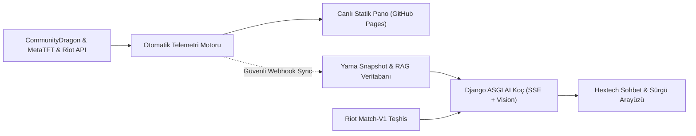

  

  

    
    
    
    
    
    
  

  

    <strong>Kişisel TFT Yapay Zekâ Koçluk Platformu &amp; Otomatik Yama Telemetri Motoru</strong> 
    <em>Live Set 18 Master+ Meta Intelligence &bull; Set 19 PBE Scout &bull; Real-Time Streaming AI Coach &bull; Board Vision &amp; Riot Match Diagnosis</em>
  

---

## Proje Hakkında

Bu proje, **Teamfight Tactics** için geliştirdiğim kişisel bir **yapay zekâ koçluk ve canlı yama telemetri platformudur**. Oyuncuların her yama değişiminde güncel meta verisine, erken oyun eşya kararlarına, 4&times;7 altıgen tahta dizilimlerine ve maç sonu hata analizine tek bir sohbet arayüzünden anında ulaşabilmesi amacıyla tasarlanmıştır.

* **Canlı Statik Telemetri Panosu (v1):** [apexq.github.io/TFT-Meta-Patch-Telemetry](https://apexq.github.io/TFT-Meta-Patch-Telemetry/)
* **Yeni Nesil Sohbet Platformu (v2):** Django ASGI + SSE Streaming + Vision + Otomatik Telemetri Senkronizasyonu (`v2-chat-platform`)

---

## Öne Çıkan Özellikler

| Yetenek | Açıklama |
| :--- | :--- |
| **Akan Yanıtlı AI Koç (SSE Streaming)** | Kelime kelime akan gerçek zamanlı koçluk yanıtları, çok turlu hafıza ve sohbet içi etkileşimli Hextech kartları |
| **Set 19 PBE İzci (`PBE_SCOUT`)** | Yeni set geçişlerini otomatik algılar; 5G–1G maliyet filtreli şampiyon kataloğu, özellik eşikleri ve erken sinerji önizlemesi sunar |
| **4&times;7 Altıgen Hex Dizilim Kartı** | Gerçek altıgen hücreli tahta konumlandırma, ana taşıyıcı vurgusu, tek tık **Tahtayı Aynala (Mirror)** ve oyun içi Team Planner kodu |
| **Ekran Görüntüsü Vision Analizi** | Sohbete yapıştırılan (`Ctrl+V`) veya yüklenen oyun içi ekran görüntüsünden tahta, bileşen ve dükkân analizi ile anlık pivot rehberliği |
| **Opener &amp; Eşya Pivot Seçici** | Eldeki başlangıç bileşenlerine göre 2-1'den 4-2'ye uzanan optimal tahta ve taşıyıcı geçiş planı |
| **Riot ID Maç Sonu Teşhisi** | Son dereceli maçlarda lobi rekabeti (*contested* birimler), harcanmamış altın (*dead gold*) ve kritik karar hatalarının analizi |
| **Çift Dil Desteği (`TR / EN`)** | Tüm koçluk yanıtları, sürgü panelleri ve arayüz bileşenlerinde kesintisiz Türkçe ve İngilizce deneyimi |

---

## Sistem Mimarisi

---

## Erişim ve Lisans

Bu repo yalnızca **kişisel proje sunumu, mühendislik vitrini ve Riot Games Developer Policy şeffaflığı** amacıyla herkese açık tutulmaktadır.

* **Üçüncü Taraf Kurulum Desteklenmez:** Bu proje barındırılan (hosted) özel bir web servisi olarak geliştirilmiştir; kişisel bilgisayarlara veya harici sunuculara kurulum/çoğaltma için açık kaynak olarak sunulmaz.
* **Lisans:** Tüm hakları saklıdır — detaylar için [LICENSE](LICENSE) dosyasına bakabilirsiniz.
* **Güvenlik Bildirimi:** Olası güvenlik bulguları için lütfen [SECURITY.md](SECURITY.md) yönergesini kullanın.

---

## Riot Games Yasal Uyarı &amp; Politika Uyumu

**TFT AI Coach &amp; Patch Telemetry**, Riot Games tarafından desteklenmemektedir ve Riot Games'in veya Riot Games ürünlerinin oluşturulmasında ya da yönetilmesinde resmi olarak yer alan kişilerin görüş ve düşüncelerini yansıtmaz. Riot Games ve Teamfight Tactics, Riot Games, Inc.'nin ticari markaları veya tescilli ticari markalarıdır.

* **Augment Politikası Uyumu:** Riot Games Geliştirici Politikaları gereği eklentilere (Augment) ait sayısal kazanma oranı, ortalama sıralama veya seçilme yüzdeleri platformun hiçbir bölümünde yayınlanmaz; eklentiler yalnızca nitel kademe, aşama ve sinerji rehberliğiyle sunulur.
