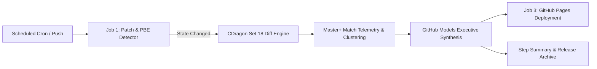

# TFT Set 18 Meta & Patch Telemetry

[](https://github.com/Apexq/TFT-Meta-Patch-Telemetry/actions/workflows/tft-meta-pipeline.yml)


An automated data engineering and meta-analysis pipeline for Teamfight Tactics (**Set 18 / `TFTSet18`**). The system tracks live client patches and Public Beta Environment (PBE) updates on CommunityDragon, calculates mathematical balance diffs across champion stats and ability scalings, and overlays those diffs onto real Master, Grandmaster, and Challenger match telemetry.

Live Dashboard (Bilingual EN / TR): `https://apexq.github.io/TFT-Meta-Patch-Telemetry/`

---

## System Architecture

The pipeline operates across three stages of the patch lifecycle without manual intervention:



1. **CommunityDragon JSON Diff Engine (`src/cdragon_client.py`, `src/diff_engine.py`)**
   Instead of scraping brittle HTML patch notes, the client downloads gzipped game data archives (`tr_tr.json` and `en_us.json`) directly from `raw.communitydragon.org`, filtering strictly for the `TFTSet18` mutator. It compares the previous live patch against the current live patch (`18.4 -> 18.5`) as well as the current live patch against the PBE branch (`18.5 -> 18.6 PBE`). Every base stat (`HP`, `Mana`, `Starting Mana`, `AD`, `AS`, `Armor`, `MR`, `Range`) and 1/2/3-star ability variable is evaluated with directional weights to produce a net `impact_score`.

2. **Master+ Composition Telemetry & Patch Impact Overlay (`src/riot_client.py`)**
   The analyzer ingests clustered composition data and placement distributions (`1st` through `8th` place counts across 320,000+ Challenger, Grandmaster, and Master matches). Each composition retains its actual board size (`7`, `8`, or `9` units), levelling tempo (`lvl 6`, `lvl 7`, `Fast 8`, `Fast 9`), primary carries, Carry Best-in-Slot (BiS) 3-item builds, and 3-star reroll targets. Champion and trait `impact_score` values from the Diff Engine are weighted across each board (carries weighted at `1.5x`) to compute a composition-level patch delta.

3. **Executive Synthesis & Bilingual Static Dashboard (`src/meta_synthesizer.py`, `src/dashboard_builder.py`)**
   Using GitHub Models (`gpt-4o-mini` authenticated via the workflow's built-in `GITHUB_TOKEN`, with a deterministic rule-based fallback for local runs), the pipeline produces executive summaries in both English and Turkish. A Jinja2 and Tailwind CSS build step outputs a zero-dependency static dashboard (`docs/index.html`) with client-side `EN / TR` language switching, instant search, tier filtering, and PBE projections.

---

## GitHub Actions CI/CD Design

The workflow (`.github/workflows/tft-meta-pipeline.yml`) implements production GitHub Actions patterns:

- **Idempotent Gatekeeper Job (`detect-patch`):** Queries DataDragon and computes SHA-256 fingerprints of the `TFTSet18` champion and trait payloads for both `latest` and `pbe`, comparing them against `data/state.json`. Downstream jobs only execute when an actual game data change is detected, when Master+ telemetry exceeds its freshness window, or when forced via `workflow_dispatch`.
- **Multi-Job Directed Acyclic Graph (DAG):** Separates change detection and unit testing (`detect-patch`), data synthesis and GitOps state commits (`analyze-set18-meta`), static site deployment (`deploy-pages`), and release archiving (`publish-release`).
- **Flat-Data GitOps Pattern:** Automatically commits updated analysis artifacts (`docs/meta_report.json`, `docs/index.html`, and `data/state.json`) back to the repository with `[skip ci]` and `paths-ignore` guards to prevent recursive workflow triggers.
- **Least-Privilege Permissions & OIDC:** Declares explicit per-job permissions (`contents: read` at workflow root; `contents: write`, `pages: write`, `id-token: write`, `models: read` scoped per job) and deploys to GitHub Pages via OIDC without third-party personal access tokens.
- **Native Observability (`$GITHUB_STEP_SUMMARY`):** Publishes Markdown tier tables and champion diff breakdowns directly to the GitHub Actions run summary page on every execution.

---

## Repository Structure

```text
TFT-Meta-Patch-Telemetry/
├── .github/workflows/
│   └── tft-meta-pipeline.yml    # 4-job GitHub Actions CI/CD pipeline
├── src/
│   ├── __init__.py              # Set 18 (TFTSet18) target constants
│   ├── cdragon_client.py        # Gzip-accelerated CDragon & DDragon version resolver
│   ├── diff_engine.py           # Bilingual champion (1/2/3-star) & trait diff calculator
│   ├── riot_client.py           # Master+ match cluster analyzer, BiS items & Riot API client
│   ├── meta_synthesizer.py      # GitHub Models AI synthesis & Discord webhook client
│   ├── dashboard_builder.py     # Jinja2 static site & GitHub Step Summary builder
│   └── main.py                  # Pipeline CLI orchestrator (--check-only / --force)
├── templates/
│   └── index.html.j2            # Tailwind CSS dashboard template with EN/TR toggle
├── tests/
│   └── test_diff_engine.py      # Unit tests for stat and ability diff scoring
├── data/
│   └── state.json               # Tracked patch versions and SHA-256 data fingerprints
├── docs/                        # Generated static site & JSON artifacts for GitHub Pages
├── pytest.ini                   # Pytest configuration
└── requirements.txt             # Python dependencies
```

---

## Local Development

```bash
# 1. Install dependencies
pip install -r requirements.txt

# 2. Run unit tests
python -m pytest -v

# 3. Execute the full Set 18 pipeline and build docs/index.html
python -m src.main --force

# 4. Run change detection only
python -m src.main --check-only
```

Open `docs/index.html` in any browser to inspect the generated dashboard locally.

### Optional Environment Variables & Repository Secrets

The pipeline runs out of the box with zero external secrets required. The following optional secrets can be configured under **Settings -> Secrets and variables -> Actions**:

- `RIOT_API_KEY`: Riot Developer API key (`X-Riot-Token`) for direct regional Challenger/Grandmaster/Master ladder telemetry (`RIOT_PLATFORM_REGION`, defaults to `tr1`).
- `DISCORD_WEBHOOK_URL`: Posts an automated patch summary embed to a Discord channel when the pipeline runs.

---

## Data Attribution & Credits

- **Master+ Composition Clustering & Carry BiS Telemetry:** Provided courtesy of [MetaTFT.com](https://www.metatft.com). Special thanks to the MetaTFT team for permitting the use of high-elo match aggregation data in this project.
- **Game Data & Assets:** Champion stats, ability scalings, trait breakpoints, and icons are sourced from [CommunityDragon](https://communitydragon.org/) and Riot Games' DataDragon CDN.
- **Official Ladder Telemetry:** Regional Challenger/Grandmaster/Master standings are queried via the official [Riot Games Developer API](https://developer.riotgames.com/).
